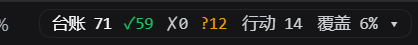

# claim-ledger · 断言台账（v0.6.1）

把 agent 说过的**完成性断言**（“我装了 / 我修好了 / 我删了 / 版本是 X / 一共 N 个”）映射到**可执行证据**，分三种状态挂在旁边。它只记录，不审查，也不拦任务。

存在的理由很简单：**“做完了”这句话，只有落到某个能跑的东西上才算数。** 二元判定（对/错）会逼着在没有证据时二选一，那时唯一聪明的答案就是猜——所以这里是三态。

```
#  t   判定         断言                                              证据
────────────────────────────────────────────────────────────────────────────────────────
1  1   ✓ verified   `dsh-see-now` 版本 0.2.9，npm 上核实过               pwsh→0.2.9 | live:0.2.9
2  1   ✗ refuted    `dsh-talk-map` 版本 0.5.9，npm 上核实过              pwsh→0.5.9 | live:0.6.2
3  1   ? unverif.   treg 索引了 2,600 个外部接口，值得一装
────────────────────────────────────────────────────────────────────────────────────────
claims 3 · ✓ verified 1 · ✗ refuted 1 · ? unverifiable 1
badge: assertions 3 · ✓1 ✗1 ?1
```

## 三种判定

| 判定 | 含义 | 依据 |
|---|---|---|
| `✓ verified` | 断言里的事实，在本轮或更早的工具输出里出现过；或现场核验通过 | 只能来自命令输出，不来自别的模型 |
| `✗ refuted` | 现场核验与断言**矛盾**（最有价值的输出） | 只由核验器给出，`{ok:false}` |
| `? unverifiable` | 没有机械证据——**不是失败**，是“待定” | 无 token / token 无出处 / 核验器崩了 |

判定三态而不是两态，是因为二元会逼核验器在没证据时二选一，它就会猜；而**猜出来的“成功”比不核验更危险**。`{crash}` 一律降级为 unverifiable，**绝不记成 refuted**。

## 用法

```bash
node cli.mjs audit   <session.jsonl[.zstd]> [--turn 1,2] [--live[=local]] [--checks f.json] [--stance action|report] [--json] [--width 130]
node cli.mjs extract <session.jsonl[.zstd]> [--turn 1,2] [--json]
node cli.mjs trends  [--dir <台账目录>] [--json]
node --test test/ledger.test.mjs test/plugin.test.mjs test/session.test.mjs test/auto.test.mjs test/trends.test.mjs test/encoding.test.mjs test/store.test.mjs test/coverage.test.mjs   # 68 个测试
```

- `--checks` 除了精确原文，还收 `{ "rules": [{ "pattern": "...", "flags": "i", "check": {...} }] }`：
  一类说法写一条正则就够，不用把每句原话抄一遍。写错的正则会被跳过，不会让整次审计崩掉。

- 会话文件：`~/.dsh/sessions/<cwd-slug>/session-<uuid>/session.v4.jsonl.zstd`（自动解 **多帧** zstd）。
- `--live` 才会跑核验；不加只做「日志内取证」。
- 退出码默认永远是 0；加 `--fail-on-refuted` 才在有 refuted 时退 2。
  **默认不拦，是因为台账一旦变成门禁，就会退化成 dsh-pua 那种“监工”**——模型会为了不被判失败而少说话、少断言。
- 想真当 pre-commit 钩子用，`--fail-on-refuted` 是留给你的开关，但请先想清楚要不要它。

## 插件形态（v0.6.0）

这个目录同时是一个 DSH bundle：`package.json` 的 `dsh.bundle.patch` 让 `cordis.patch.yml` 插入一条入口，
`index.js` 做三件事：注册一个**只读工具** `claim_audit`、在每个 `turn/end` 之后**自己记一次账**、
把当前会话的台账通过**投影**送进输入框下面的徽章。

| 参数 | 说明 |
|---|---|
| `session` | 会话日志路径 / 会话目录 / 会话 id；省略则审调用者自己的会话（由 agent id 反查） |
| `turns` | 只审指定回合，如 `"2,3"` |
| `live` | 对已知形状跑一次只读现场核验，默认关 |
| `checks` | 断言原文 → 核验动作的 JSON 文件 |
| `recorded` | 读它自己记的账，不重新读日志 |
| `trends` | 读跨会话的走势（每会话首现 `?` 的回合、哪类断言从没被核实过） |
| `stance` | 只看 `action`（我做了什么）或 `report`（世界是什么样） |
| `unbacked` | 列「有完成动词但没有任何事实 token」的句子——它们从不进台账，也不判定 |
| `errors` | 看 `errors.log` 尾巴：记账自己失败的地方（它不会打断会话） |
| `limit` | `errors` 取多少行，默认 20 |
| `badge` | 直接给客户端徽章的那份原始数字（JSON），用来核对徽章与最近一次审计是否一致 |

它不写会话、不改对话、不拦回合。核验本身出错永远降级成 `?`，绝不记成 `✗`。
安装：Plugins → Add plugin → 选择本目录；装好后 `claim_audit` 出现在工具列表里。
本机装法是 `plugin_manager install_bundle`，装完是 `node_modules/dsh-claim-ledger` 的 junction 指向本目录；
**改了代码要重载**：`plugin_manager set_plugin include:claim-ledger enabled=false` 再 `enabled=true`（entryId 必须是 `include:<patch id>`）。

## 自动记账

回合结束时（`session/event` 里的 `turn/end`），插件拿**内存里这个会话的事件**算一次台账并落盘：

```
~/.dsh/claim-ledger/<sessionId>.json   最新快照：每回合计数 + 全部断言
~/.dsh/claim-ledger/journal.jsonl      每回合一行，用来看走势
~/.dsh/claim-ledger/errors.log         记账自身失败的地方（平时不存在）
```

为什么用内存事件而不是重读日志：日志是多帧 zstd、上千行，`turn/end` 又发生在 emit 里，
重读既慢又是竞态。插件在会话中途加载时，会在第一轮（或第一个 `turn/end`）用日志补一遍历史事件，
否则「证据在上一轮工具输出里」会被误判成 `?`。子代理的会话目录名**不带 `session-` 前缀**，两种都要认。

自动那一档**只跑本机文件核验**（路径存在/不存在、文件包含、文件是否干净），不发网络请求、不起进程；
`npm_version` 和只读命令留在手动 `--live` 里。

### 配置（v0.4.0）

| 键 | 默认 | 说明 |
|---|---|---|
| `enabled` | `true` | `false` 时工具仍注册，但不再订阅 `session/event` / `session/disposed`，也就是不记账 |
| `dir` | `""` | 台账目录，空则用 `~/.dsh/claim-ledger` |
| `debounceMs` | `250` | 同一会话重复 `turn/end` 只跑最后一次 |
| `live` | `"local"` | 自动那一档的核验强度；`"none"` 表示只做日志内取证 |

schema 是**带兜底**拿的：插件以 junction 装进 profile，node 按真实路径解析，裸 `import('@deepseek-ai/schemastery')`
经常拿不到；拿不到就不导出 `Config`（照常激活），配置值一律按可选防御式读取——宁可少一个表单，
也不能因为少一个包就整条链路起不来。

本机实测：把 `@deepseek-ai/schemastery@3.19.0` 装进插件自己的 `node_modules` 之后，
`createRequire(import.meta.url).resolve()` 那条兜底能拿到包，面板里的 Config 状态从 `absent` 变成 `schema`，
四个键（含中文说明与默认值）都能正常投影出来。

### 性能（v0.4.0）

改造前每个 `turn/end` 都把整个会话全量重算：329 回合的会话一次 2 523 ms，累计是分钟级，
而且同步跑在 `session/event` 的 emit 里。现在是增量 + 倒排索引：

| 会话 | 回合 | 全量 | 增量 | 最慢一回合 |
|---|---|---|---|---|
| session-c092 | 329 | 85.7 ms | 62.2 ms | 1.8 ms |
| session-023d | 80 | 46.2 ms | 38.8 ms | 8.9 ms |
| session-3cca | 19 | 14.2 ms | 8.4 ms | 1.1 ms |

三个会话的逐条判定与全量结果完全一致（`sameClaims / sameVerdicts / coverageSame` 全为 true）。
正确性靠规则本身：证据只能来自断言之前或同一回合，所以先判定的回合不会被后来的证据改变。

### 台账维护（v0.4.0）

- `session/disposed` 时清掉该会话的内存尾巴（`tail.forget` / `recorder.forget`），长开的应用不会越跑越大。
- `pruneLedger()`：快照最多留 200 个、最多 30 天；`journal.jsonl` 超 4 MB、`errors.log` 超 256 KB 只留尾巴，
  并且从行首切断，不写半行。每 20 次记账跑一次。
- 被删掉的快照是**真删**，不是改名成 `.pruned`——不然「清理」只是把垃圾换个名字留着。

## 徽章与面板（v0.6.0）

输入框下面多一行小徽章，点开是这张会话的完整台账：

```
台账 71  ✓59 ✗0 ?12   行动 14   覆盖 6%  ▾
```



上面这张是真实截图，不是画出来的示意图：数字和 `node cli.mjs audit <会话> --live=local`
的输出逐项一致。

展开后是面板：上面几行是分类计数，下面可以按「全部 / 行动 / 陈述 / ✗被推翻 / ?测不到」
筛选，逐条列出每句断言——`t13 行动 ✓ 我把 README 重写了。` 这种，判定用颜色区分，
每条下面附核验说明（为什么是 `?`、哪条核验跑成了什么）。面板最多带最近 300 条，
更早的用一行字报数（一次会话可能几百条断言，全塞进客户端快照既没人看完也不该这么大）。

- 数字来自宿主投影 `claim-ledger`（`src/projection.mjs`，`stateVersion: 2`）：`init` 给空徽章，
  `apply` 只在 `turn/end` 时换一个新对象，`wire.view` 原样返回。宿主按 `Object.is` 判断变化，
  所以每进一个回合客户端才会收到一次更新——不是每来一条事件都重画。
- 投影状态里就存着那份精简记录（`rows`，每条形如 `{turn, stance, kind, verdict, quote, note}`，
  引文与说明各裁到 120 / 160 字），客户端只做筛选与排版，不自己算判定。
- 客户端那一半在 `client.js`：`ctx.slots.register({ name: 'conversation.composer.dock', id: 'claim-ledger', order: 2 })`，
  排在内置的 `activity`(0)、`usage`(1) 之后，**并排新增，不替换**它们。
- 徽章只读投影，不读文件、不起 HTTP 路由。这条是故意的：起一条本机路由等于给任何网页开一个无鉴权的读接口
  （市面上 548 个插件在设计上就是这么干的），而投影走的是宿主的私有快照通道。
- 数据源是**同一份**内存台账：自动记账与徽章不再各算一遍，谁先到谁算，另一个直接读结果。
- 想核对徽章与工具输出是否一致：`claim_audit { badge: true }` 打的就是徽章那份 JSON。
  注意口径差：徽章用的是配置里的 `live`（默认 `local`，会探本机文件），所以它比
  `claim_audit { live: false }` 少几个 `?`。要跟徽章逐条对齐就用 `node cli.mjs audit <会话> --live=local`
  （本机实测两者同为 `71 条 · ✓59 ✗0 ?12 · 行动 14 · 覆盖 6%`；换成 `live: false` 是 `✓56 ?15`）。
- 徽章不显示 `?` 之外的判断：`?` 是「没有可执行核验」，不是通过；纯链接、无动作词的句子不判定。
- 没进过回合的会话不显示徽章（避免空徽章占着输入框下面）。

已知边界：改完 `client.js` 要**刷新页面**才看得到（宿主 reload 不带客户端）。
2026-11-26 用户在 Web GUI 里刷新后看到了徽章并截图确认（当时显示 `台账 71 ✓59 ✗0 ?12 行动 14 覆盖 6%`），
所以「自定义 key 的 wire 能投到 `useProjection`」这一环已经由真机验收，不再只是源码推断。

## 两类断言

同一个台账里混着两种话，它们的重量完全不一样：

- **行动（action）**：第一人称或完成动词——「我装好了」「已删除」「跑通了」。这是插件存在的理由。
- **陈述（report）**：在说世界是什么样——「这个插件有 45 项成就」「共 837 帧」。它们也会被核，但一堆带数字的介绍能把行动类淹掉，所以徽章单独数行动类。

实测本机一个 10 回合的会话：42 条断言里只有 10 条是行动类，其余 32 条是调研笔记里的数字。只看 `✓37` 会误以为整轮都核过了；看 `行动 10（✓7 ?3）` 才知道真正被核的活儿有多少。

三条容易出错的细节，都已写成测试：

- **省略号截断的 token 不是事实**：`D:\…docx` 标成 `elided`，不要求它出现在输出里、也绝不拿它去探路径。否则会得出「本机没有这个路径」这种误导性附带结论。一句里既有真路径又有截断路径时，只要求真路径有出处。
- **引号里的话不算这句的立场**：转述「我装不了」不是我在声明做不到，`stance` 只看引号外（`unquoted()`）。但否认类判定**不分立场**。
- **否认类断言不能靠日志升级**：token 出现在输出里只证明那个名词存在，证明不了「做不到」。这类句子要么有报错输出（含 error / denied / EACCES），要么留 `?`。

另外有一条**只认存在、不认不存在**的探针：断言里带本机路径、又没匹配上任何自动核验动作时，会做一次 `path_exists`。
存在就升到 `verified`（只证明路径在，不证明句中其它说法）；不存在就留在 `?`，不记推翻——因为没声明是自己刚创建的东西，缺失可能就是预期。

## 写入取证（v0.3.0）

「我把 X 写好了」是这个插件最该管、却一直管不到的一句话。原因是取证通道错了：`write` / `edit` 的**回执**通常只有 `Updated file`，路径根本不在回执里，只存在于**调用参数**里。所以 v0.3.0 把 `tool/call` 的 `arguments` 收了进来，作为第二证据通道（`turn.calls`）。

判定规则（只对**写入族工具** `write` / `edit` / `multi_edit` / `apply_patch` 生效）：

| 情况 | 判定 |
|---|---|
| 入参里出现该路径 + 文件存在 + 文件干净 | `✓ verified`（live）：`write 入参命中 + 文件存在 + 是干净 UTF-8` |
| 入参里出现该路径 + 文件不存在 | `✗ refuted`：写了但东西不在 |
| 入参里出现该路径 + 文件在但内容坏了（BOM / 非法 UTF-8 / U+FFFD） | `✗ refuted`：写了，但写坏了 |
| 入参里没有该路径（哪怕文件确实在） | `?`：没有写入动作，文件在也说明不了什么 |

最后一条是这次改动的重点：以前带「写好了」的句子会被通用存在性核验接管，只要文件在就 `✓`——那正好是最容易骗过人的情况。

为此新增核验类型 `file_clean`（严格 UTF-8、无 BOM、无 U+FFFD）。它是被真实事故逼出来的：用 shell 改带中文的文件，按 GBK 读、按 UTF-8 写回，文件「存在、能跑」，内容已经变成乱码。`file_contains` 表达不了「不许有这种字符」。

**边界（不覆盖，别指望它）**：

- 用 `pwsh` 之类的 shell 写文件不算：入参里有路径不代表真的写了。宁可留 `?`，不要猜。
- 子代理写的文件不算：它不在这个会话的调用记录里。
- 相对路径不算：入参是绝对路径，句子里的 `README.md` 没有 token，根本进不了台账（这仍是局限 1）。

**留下的两个真实坑**（都已写成测试）：

1. 日志里的 `arguments` 是**字符串**（JSON 编码过一次），直接 `JSON.stringify` 会双层转义，路径变成 `D:\\\\deepseek\\\\...`，比对全部落空。第一次冒烟就是这样：真写入被判成 `verified·log`（靠回执里偶然出现的路径），而不是要走的新通道。
2. JSON 里反斜杠是 `\\`、工具输出里是 `\`，不归一化永远匹配不上。

另外加了一条**自检测试** `test/encoding.test.mjs`：扫描项目自己的所有文本文件，任何「非法 UTF-8 / BOM / 替换字符」都让测试失败。cli.mjs 当初就是被 shell 写坏的（能跑，但中文全是乱码），扫描时才被发现。

## 覆盖率（v0.3.1）

上面的所有判定都有一个前提：**句子得带 token**。而「改好了」「碰撞箱已经修好了」「README 里也写好了这一节」这种话一个数字、一个版本号、一个绝对路径都没有——它们根本不进表，徽章上一条都不会少。

所以 v0.3.1 在表格末尾多输出一行：

```
完成性断言 15 句 · 有 token 可查 1 句（7%）· 没有 token 14 句（不进表，未取证）
  · t4 原型已经跑起来了。
```

四个数：本期「我把它做完了」这种句子几句、其中几句有 token、几句没有（不判定，只是承认看不见）。`badge` 后面也带上 `· 覆盖 7%`。

**这个数字才是这套东西真正的自我评价**：`✓41 ✗0 ?8` 看着漂亮，但那 41 条只覆盖了「我说我干了什么」的十分之一。全量 10 个会话实测是 **207 句完成性断言、21 句可查（10%）**。

统计口径（写死在 `src/extract.mjs` 的 `doneSentences`）：

- 只数**完成式**：`已/已经 + 动作词`、`X好了`、`跑通了 / 搞定了 / 完成了`。
- 排除**条件句与计划**：带「如果/再谈/准备/以后/应该/可以/例如」的不算——「跑通了再谈扩展」不是事实。
- 排除**第三人称与定语**：「作者自己迁移了」「已装的插件」不算我在报功。
- 有 token 的句子未必都进了表（要真被抽成断言），所以这是覆盖率的**上界**，不是精确值。
- 例外（v0.6.1）：「跑通类」句子没有 token 也可能进表——靠同回合执行输出里的成败标志取证，见下一节。

**边界**：句子里的相对路径（`README.md`）没有 token，所以「我更新了 README」仍然是看不见的那一类——这正是当初骗到我的那句。

要看具体是哪几句，用 `claim_audit({ unbacked: true })`（v0.4.0）：它把这类句子逐条列出来（最多 200 条，展示 60 条）。
覆盖率是比例，清单是证据——只有比例的话，没人能反驳「那 90% 到底是什么」。

## 跑通类断言（v0.6.1）

「测试跑通了」「构建通过了」这类句子**一个 token 都没有**，以前连表都进不去。但它们其实有机械把手：同一回合的**执行类工具输出**里有没有成败标志。

规则（`src/ledger.mjs` 的 `runEvidence`）：

| 输出里出现的 | 判定 |
|---|---|
| `N failed`（N > 0） | **refuted**——哪怕同一份输出里也写了 `5 passed` |
| 成功标志（`N passed` / `all tests passed` / `0 failed` / `全绿` / `build succeeded`），且这份输出里没有别的失败字样 | **verified · tool** |
| 只有失败字样（`error` / `失败`），没有明确成功标志 | 留 `?`——不推翻也不敢记通过 |
| 本回合没有执行类工具的输出 | 留 `?`，note 写「测不到」 |

只有**执行类工具**算数（`pwsh` / `shell` / `node` / `npm` / `python` / `git` …）。这条限制是被一个真实假阳性逼出来的：第一版把全池都算了，结果 `compress` 的输出里恰好有个 `✓`，就把「自动记账已经跑通了」判成了 verified——纯属巧合。

第二个真 bug：`0 failed` 里含 `failed`，一开始整句被当成失败输出，成功标志永远不生效。现在先把这个短语从文本里抹掉再判失败字样。

**实测（15 个真实会话）**：跑通类断言 28 条 → `✓4 ✗0 ?24`。四条 verified 逐条看过证据，都是执行工具真输出：`SUCCESS: Animated character exported to …`、`node --test` 的通过行。没有一条是巧合。覆盖率从 52/291 变成 56/291（19%）。

**边界**（同样是能力披露）：

- **只看本回合**，不看前几回合——「昨天跑通了，今天说跑通了」不互相背书。
- **只证明这一回合有成功标志**，不证明那条链路整体跑通（note 里写死了这句话）。
- 子串匹配仍可能有假阳性；真要不漏，只能接 `--live` 的 `command` 核验跑一遍。

## 走势

单轮台账回答「这句当时被核了吗」，走势回答另外两件事：**从第几个回合开始不确定**、**哪类断言从来没有被核实过**。
`claim_audit({trends:true})` 或 `node cli.mjs trends` 读的是已经落盘的 `journal.jsonl` 与快照，不重新解析日志。

```
会话          回合  断言  ✓   ✗   ?   首个?
3ccad9ef      2     78    71  0   7   t10
69beb97e      1     1     1   0   0   —
有 ? 的会话 3/4

断言类型（来自 4 个快照，节选）
陈述·数字      19   19   0   0
行动·路径      5    0    0   5     ← 从没被核实过
陈述·版本号    7    5    0   2
```

`行动·路径` 5 条全是 `?`，是这份数据里唯一有信息量的结论。我当时的假说是「工具回执不带路径原文，取证缺了一块」——
**这个假说被数据推翻了**：逐条打开看，5 条里没有一条是「我写到 X 但回执没写 X」。真实构成是 2 条 `D:\…docx`（省略号截断的路径）和 3 条「我装不了」这类否认类断言的转述。
修掉这两处后，同一会话的行动·路径从 5 条降到 3 条，**剩下的 3 条 `?` 每条都有如实的理由**，而不是一个含糊的「没找到证据」。
这个类型仍然 0 条 verified——但它不再是「原因不明的红」，而是一组各自成立的「核不了」。

`t10` 是主会话第一次出现 `?` 的回合；`?` 早出现通常说明取证没跟上，而不是谎报。

## 断言如何被抽出

`src/extract.mjs` 只留**带事实 token** 的句子，token 三类：版本号 `\d+\.\d+\.\d+`、
绝对路径、三位以上数字（含千分位）。没有 token 的句子不抽——这是刻意的 precision-over-recall：
**宁可漏，也不要让一句废话被假的 verified 洗白。** 代码块内容剔除（那是命令和配置，不是断言）。

## 核验词表（封闭，`src/checks.mjs`）

| type | 作用 | refuted 条件 |
|---|---|---|
| `path_exists` | 路径存在 | 不存在 |
| `path_absent` | 路径不存在 | 存在 |
| `file_contains` | 文件含某串 | 不含 |
| `file_clean` | 文件是干净 UTF-8（无 BOM、无 U+FFFD） | BOM / 非法 UTF-8 / 替换字符 |
| `npm_version` | 查 registry latest | 版本不符 |
| `command` | 跑白名单只读命令 | 退出码非 0 |

`command` 白名单：`node` / `git` / `python` / `python3` / `curl`。
**不含 npm**：Windows 上 npm 是 `.cmd` shim，`spawnSync(..., {shell:false})` 直接 `EINVAL`；
`npm_version` 改成子 node 进程 fetch `https://registry.npmjs.org/<pkg>/latest`，绕开 shim 与 shell。

## 证据的时间约束

证据必须出现在断言**之前或同一轮**：同一个回合里先说后跑也算，因为 `turn.tools` 是先入池再判定的。
后一轮的工具输出**不能**回头证明前一轮说过的话——否则“我修好了”永远能在下一轮被自己修好后追认为真。

## 现在跑出来的结果

```
node cli.mjs audit samples/demo-session.jsonl --live --checks samples/demo-checks.json
→ claims 3 · ✓1 ✗1 ?1     # talk-map 0.5.9 被判 ✗：registry 上现在是 0.6.2（真实 drift）
```

本机真实会话（`session-3ccad9ef`，10 个回合，`--live`）：

```
claims 42 · ✓ verified 37 · ✗ refuted 0 · ? unverifiable 5 · live 核验 1
其中行动类 10 条：✓7 ✗0 ?3
```

5 条 `?` 分别是：3 条「我装不了」这类否认类断言、2 条含 `D:\…docx` 省略号路径的自审描述。全部有如实理由，没有一条是「找不到证据所以放着」。

写入取证的冒烟（一个真的写了、一个没写却声称写了，`--live=local`）：

```
claims 2 · ✓ verified 1 · ✗ refuted 0 · ? unverifiable 1 · live 核验 1
t1 行动 ✓ verified·live  我把 D:\...\real.md 写好了。                    ← write 入参命中 + 文件干净
t1 行动 ? unverifiable   我把 D:\...\never-written.md 写好了。           ← 没有写入调用，文件也不在，留 ?
```

第二条很关键：文件不存在**也没有**被判 `✗`。因为「没有写入动作」不等于「你说谎」——可能是我在别处写的、或者路径写错了。真正会判 `✗` 的只有两种：入参命中但文件不在，或文件在但内容坏了。

覆盖率（v0.3.1，10 个会话全量）：

```
claims 910 · ✓841 ✗2 ?67
完成性断言 207 句 · 可查 21（10%）· 无 token 186
```

换句话说：那 841 个 `✓` 覆盖的是「我说我干完了」的**十分之一**。这不是工具坏了，而是它诚实地报出了自己的视野。

## 局限（说清楚，免得被当成万灵药）

1. **只核 token，不核语义**：`✓` 只保证句子里可执行的那部分（版本号 / 路径 / 数字），不保证「我装好了」这半句成立。一个 `✓` 不等于整句话为真。
2. **`?` 不等于通过**：纯链接、没有动作词的句子不判定；只写文件名不写路径的句子也不判定。
3. **自动核验只覆盖不会误判的形状**：带「已删除 / 已清理」的路径断言、带「成品在 / 备份在 / 另存」的路径断言，以及**写入族工具入参命中**的写文件断言。其余留在 `?`，靠 `checks` 文件补。
4. **纯 markdown 链接里的路径不探**（`[预览](D:\x.png)`）：正文举例会误报。这是 2026-11-26 跟用户确认过的决定。
5. **省略号截断的路径永远核不了**：`D:\…docx` 只是句子里的省略，不是事实。
6. **抽取有下限**：数字为 0 条不代表这个会话可信，只代表没有可提取的事实。
7. **它不是门禁**：没有非零退出码，不会因为出现 `✗` 就拦住任何事。是否改写、是否补救，由看到账本的人决定。
8. **UI 只做了徽章**：输入框下有一行可展开的徽章；完整的「面板页」没做，工具输出与 CLI 仍是主入口。
9. **shell 写文件不取证**：`pwsh` 的入参里出现路径不能证明真写过，所以「用命令写好了 X」这类仍然是 `?`（或只靠回执里的 token）。这是刻意的：宁可漏，不要给假 `✓`。
10. **客户端渲染靠人工验收**：没有浏览器控制，徽章长什么样只能刷新页面目视。2026-11-26 已验收过一次（见上节），但以后每次改 `client.js` 仍要人工看一眼。

## 插件化路线（Host 与徽章已完成）

- ✅ Host：`turn/end` 自动记账 + `claim_audit` 工具（11 个参数）+ 4 项 Config。
- ✅ CLI：`audit` / `extract` / `trends` 三个模式。
- ✅ Client 徽章：`conversation.composer.dock` 上的一行可展开徽章，数据走 `sessionProjections` 的 `wire`。
  可行性靠读 `@deepseek-ai/dsh-session-projection` 源码确认：运行期 `acquire()` 接受任意 key，
  `snapshot()` 只按 `registration.def.wire !== undefined` 过滤——**没有 key 白名单**，
  「第三方 key 的 wire 落在 host-only 重载」只是 TypeScript 层的约束，不是运行期限制。
  额外条件都满足了：`stateVersion` 是非负安全整数、`stateSchema` 用 zod（拿不到时退化成手写 `.parse`）。
- ⬜ 更完整的面板页（列表 + 逐条断言）没做；徽章点开只到「被推翻的 5 条 + 覆盖率」这一层。
- ✅ 面板上必须明示的边界（用户 2026-11-26 要求）：「`?` = 没有可执行的核验，不是通过；纯链接、无动作词的句子不判定。」——这句话在徽章展开区里。

## 文件

```
index.js            Host 入口：注册 claim_audit + 订阅 session/event、session/disposed + 注册徽章投影
client.js           客户端徽章：conversation.composer.dock 上的 slot（React，用 --dsw-alias-* token）
cli.mjs             audit / extract / trends
src/session.mjs     读会话日志（多帧 zstd）、单趟把事件并成回合（createGrouper）
src/extract.mjs     分句、取 token、立场分类、省略号标记、完成式识别
src/ledger.mjs      createLedger()/audit()：证据池 + 倒排索引、三态判定、写入取证、探针、curatedFor()
src/checks.mjs      封闭核验词表（6 种，含 file_clean）
src/resolve.mjs     会话 id / 目录 / 文件 → 日志路径
src/store.mjs       台账落盘、读 errors.log、pruneLedger()
src/tail.mjs        内存事件尾巴（按 seq 去重，复用 createGrouper）
src/auto.mjs        turn/end 后构建快照 + 防抖 recorder（台账共用 live store）
src/live.mjs        会话级实时台账：自动记账与投影共用一份计算
src/projection.mjs  徽章投影定义（key/stateVersion/init/apply/wire + schema 兜底）
src/trends.mjs      跨会话走势 + 断言类型分桶
src/render.mjs      表格、徽章、快照面板、走势表、未取证清单、错误尾巴（CJK 宽度）
test/               73 个测试（ledger / plugin / session / auto / trends / encoding / store / coverage / projection）
samples/            演示会话与 checks 文件
docs/DETAIL.md      插件详情页
docs/preview.svg    工具输出的真实渲染（由 .tmp 脚本从 audit 结果生成）
locale/{en,zh}.json 展示元数据
icon.svg            64×64 图标
cordis.patch.yml    插入条目 include:claim-ledger
LICENSE / CHANGELOG.md / SECURITY.md
```

## 安全与能力披露

它读文件、读环境变量，`live: 'all'` 时还能起子进程——这些能力都是必需的，但**必需不等于无所谓**。每一条用在哪、能碰到什么、碰不到什么，都写在 [SECURITY.md](SECURITY.md) 里。

分析平台（Socket 之类）会把「读文件 / 读环境变量 / 起子进程 / 出现 URL 字符串」通通标成告警。那是**能力披露，不是漏洞**：一个要做核验的插件不可能既读文件又不触发它们。该看的是那张表——能力在不在、默认开没开、能不能被滥用；删功能能把分数做成 100，但那是把工具做没了。

